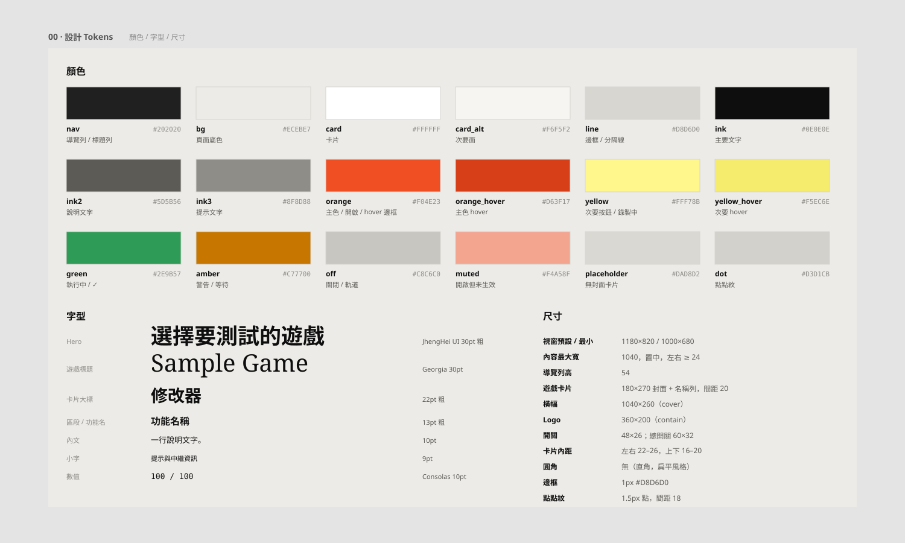
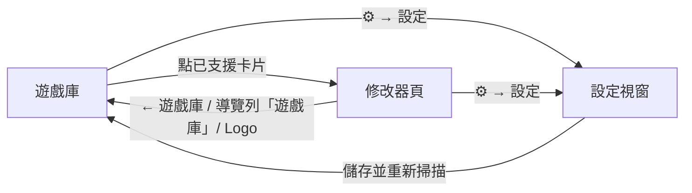
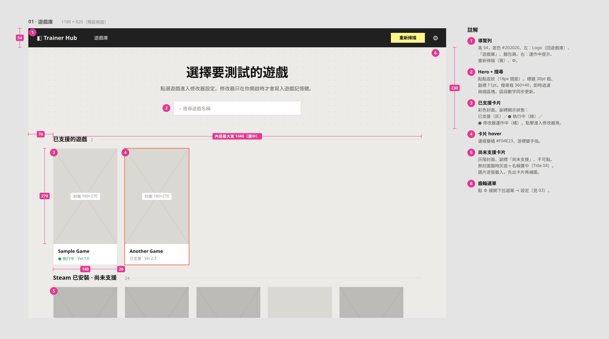
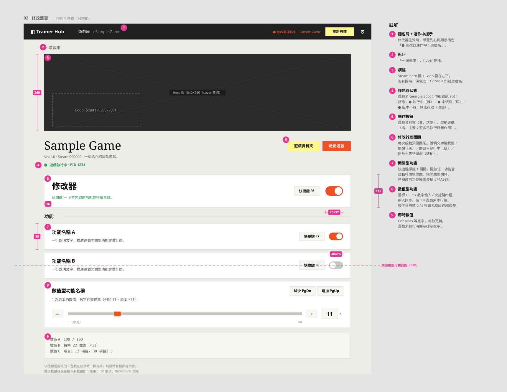
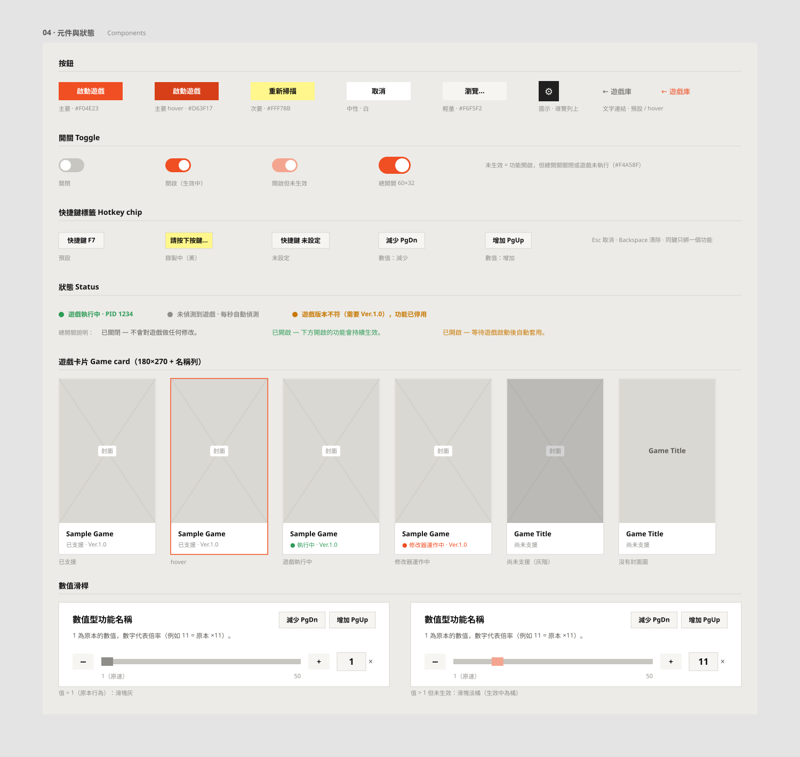
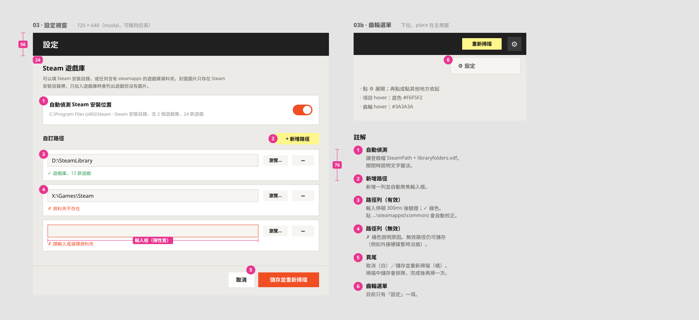
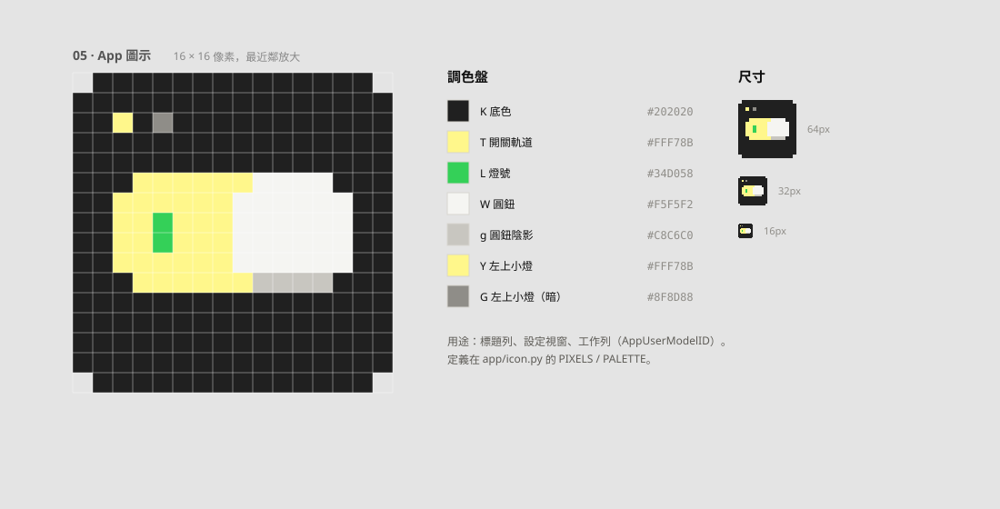

# Trainer Hub UI / UX 規格

> 對應程式：`app/main.py`（樣式常數 `C` / `F` 在檔案開頭）、`app/icon.py`。
> 設計稿在 `docs/ui/*.svg`：Figma 風格的**假資料框架**＋紅色標線＋編號註解，由 `tools/gen_ui_mockups.py` 產生（見文末）。

| 設計稿 | 內容 |
|---|---|
| [00-tokens.svg](ui/00-tokens.svg) | 色票、字級、尺寸 |
| [01-library.svg](ui/01-library.svg) | 遊戲庫框架 |
| [02-trainer.svg](ui/02-trainer.svg) | 修改器頁框架（整頁） |
| [03-settings.svg](ui/03-settings.svg) | 設定視窗、齒輪選單 |
| [04-components.svg](ui/04-components.svg) | 元件與所有狀態 |
| [05-icon.svg](ui/05-icon.svg) | App 圖示像素規格 |

## 1. 設計原則

| 原則 | 具體做法 |
|---|---|
| 參考 melius.com 的語彙 | 深色導覽列、暖灰點點底紋、大字標題、白色卡片、橘色主按鈕、黃色次要按鈕、細邊框、少陰影 |
| 安全預設 | 修改器總開關**每次啟動都是關閉**；關閉時明確告知「不會對遊戲做任何修改」 |
| 狀態一眼可見 | 遊戲偵測狀態用顏色圓點＋文字（綠＝執行中、灰＝未偵測、琥珀＝版本不符/無法存取）；導覽列右側顯示「修改器運作中」 |
| 遊戲中也能操作 | 全域快捷鍵＋提示音，不需要切回視窗 |
| 不打擾 | 不跳出確認對話框；錯誤在原位以文字顯示（例如路徑 ✗ 說明） |
| 少即是多 | 已移除頂部黃色公告條（「目前支援…」），判斷為不必要資訊 |

## 2. 設計 tokens



### 顏色（`C`）

| Token | 色碼 | 用途 |
|---|---|---|
| `nav` | `#202020` | 導覽列、設定視窗標題列、圖示底色 |
| `nav_fg` / `nav_dim` | `#F5F5F2` / `#9C9A95` | 導覽列文字 / 次要文字（麵包屑） |
| `bg` | `#ECEBE7` | 頁面底色（暖灰） |
| `dot` | `#D3D1CB` | 遊戲庫標題區的點點紋（間距 18px） |
| `card` / `card_alt` | `#FFFFFF` / `#F6F5F2` | 卡片 / 次要面（快捷鍵標籤、輸入框、即時數值區） |
| `line` | `#D8D6D0` | 1px 邊框、分隔線 |
| `ink` / `ink2` / `ink3` | `#0E0E0E` / `#5D5B56` / `#8F8D88` | 主要 / 說明 / 提示文字 |
| `orange` / `orange_hover` | `#F04E23` / `#D63F17` | 主按鈕、開關開啟、卡片 hover 邊框、運作中狀態 |
| `yellow` / `yellow_hover` | `#FFF78B` / `#F5EC6E` | 次要按鈕（重新掃描、遊戲資料夾、+ 新增路徑）、快捷鍵錄製中 |
| `green` | `#2E9B57` | 執行中、✓ 驗證成功 |
| `amber` | `#C77700` | 版本不符、等待遊戲、無法存取 |
| `off` | `#C8C6C0` | 開關關閉、滑桿軌道 |
| `placeholder` | `#DAD8D2` | 沒有封面圖時的卡片底色 |
| 開關「已開但未生效」 | `#F4A58F` | 功能開啟但總開關關閉 / 遊戲未執行（淡橘） |

### 字型（`F`）

- 中文：`Microsoft JhengHei UI`；英文大標題：`Georgia`（遊戲名稱）；數值：`Consolas`。
- 層級：Hero 30 粗 → 頁面標題 Georgia 30 → 卡片大標 22 粗 → 區段 13 粗 → 功能名 13 粗 → 內文 10 → 小字 9。

### 尺寸

| 項目 | 值 |
|---|---|
| 視窗預設 / 最小 | 1180×820 / 1000×680，開啟時置中 |
| 內容最大寬度 | 1040（左右 padding 至少 24，置中） |
| 遊戲卡片 | 封面 180×270 + 名稱/副標，固定尺寸，間距 20 |
| 修改器橫幅 | 1040×260（cover 裁切），Logo 360×200（contain）疊在左下 |
| 開關 | 一般 48×26；總開關 60×32 |
| 導覽列高 | 54 |

## 3. 整體架構

```
┌──────────────────────────────────────────────────────────────┐
│ ◧ Trainer Hub   遊戲庫  › FrontLine        ●運作中  [重新掃描] ⚙ │  ← 導覽列（#202020）
├──────────────────────────────────────────────────────────────┤
│                                                              │
│                 （頁面：遊戲庫 ／ 修改器頁）                     │  ← 可捲動，內容置中
│                                                              │
└──────────────────────────────────────────────────────────────┘
          ⚙ → 下拉選單 [設定] → 設定視窗（獨立、modal）
```



### 導覽列

- 左：Logo「◧ Trainer Hub」（點擊回遊戲庫）、「遊戲庫」、麵包屑 `› 遊戲名稱`（在修改器頁時）。
- 右（由右至左）：⚙ 齒輪 → 「重新掃描」（黃）→ 修改器運作中提示（橘，只在有遊戲的修改器生效時出現）。

## 4. 遊戲庫



- **Hero**：點點底紋＋「選擇要測試的遊戲」＋說明「修改器只在你開啟時才會寫入遊戲記憶體」＋搜尋框。
- **已支援的遊戲**（數量）：彩色封面；副標顯示狀態
  - `已支援 · Ver.1.49`（灰）／`● 執行中 · Ver.1.49`（綠）／`● 修改器運作中 · Ver.1.49`（橘）
  - hover 時邊框變橘、游標變手指；點擊進修改器頁。
- **Steam 已安裝 · 尚未支援**（數量）：灰階封面、副標「尚未支援」、不可點。

- 封面來源優先序：直式封面 → 遊戲資料夾內的圖（已支援遊戲的 `fallback_art`）→ 橫式標頭圖置中 → 只顯示名稱的灰底卡。
- 圖片逐張載入（先出卡片、圖片轉好一張補一張），不會卡住介面。
- **搜尋**：即時過濾兩個區塊（不分大小寫，比對名稱），區段數字跟著更新。

- **空狀態文案**：
  - 掃描中：「正在掃描 Steam 遊戲庫…」
  - 搜尋無結果：「沒有符合的遊戲」
  - 完全沒有 Steam 遊戲：「找不到 Steam 遊戲。請點右上角 ⚙ → 設定，加入 Steam 安裝目錄或遊戲庫資料夾。」

## 5. 修改器頁



由上到下：

1. **← 遊戲庫**（hover 變橘）
2. **橫幅**：Steam hero 圖＋Logo；沒有圖時深色底＋斜體遊戲名稱。
3. **標題列**：遊戲名（Georgia）、`版本 · Steam AppID · 一句介紹`、偵測狀態；右側「遊戲資料夾」（黃）、「啟動遊戲」（橘，透過 Steam 啟動，遊戲已執行時無作用）。
4. **修改器總開關卡**（大）：快捷鍵標籤＋大開關，說明文字隨狀態變化（見 §7）。
5. **功能**：每個開關型功能一張卡（名稱、說明、快捷鍵、開關）。
6. **數值型功能**（移動速度）：見下圖。
7. **即時數值**（等寬字）：血量、移速、各武器彈匣；遊戲未執行時顯示「遊戲執行後會在這裡顯示即時數值。」
8. **提示**：快捷鍵是全域的、如何變更快捷鍵。

### 數值型功能卡（移動速度）

```
移動速度                                   [減少 PgDn] [增加 PgUp]
1 為原本的走路速度，數字代表倍率（例如 11 = 原速 ×11）。
[ − ]  ━━━━■━━━━━━━━━━━━━━━━━━━━━━━━━━━━  [ + ]  [ 11 ] ×
       1（原速）                         50
```

- 四種輸入方式同步：拖滑桿、按 −/+、輸入數字（Enter 或離開輸入框時套用；只接受 1–3 位數字，超出範圍自動夾住）、快捷鍵（按住 0.4 秒後每 0.08 秒連續調整）。
- 滑塊顏色：值 = 1（原速）灰；值 > 1 且生效中橘；值 > 1 但未生效淡橘。
- 套用失敗（遊戲程式碼與預期不符）時，說明文字改為橘色警告。

## 6. 快捷鍵



- 標籤格式：`快捷鍵 F6`、`減少 PgDn`、`增加 PgUp`；未設定時 `… 未設定`。
- 點標籤 → 變黃色「請按下按鍵…」→ 按任意鍵完成；**Esc** 取消、**Backspace / Delete** 清除；修飾鍵（Shift/Ctrl/Alt/Win）單獨按不算。
- 同一個按鍵只能綁一個功能：新綁定會自動清掉舊的。
- 全域生效（遊戲在前景也有效）。回饋音：
  - 開啟：880 → 1320 Hz（上升）；關閉：660 → 440 Hz（下降）
  - 數值調整：單音，頻率隨數值升高（400 + 值×40 Hz）；連發時不出聲
- 預設：總開關 F6、無限子彈 F7、無限生命 F8、移速 PgDn / PgUp（避開 F10 選單鍵、F11 全螢幕）。

## 7. 狀態與行為規則

### 遊戲偵測（每秒）

| 狀態 | 顯示 | 修改器 |
|---|---|---|
| 未偵測到 | 灰 `● 未偵測到遊戲 · 每秒自動偵測` | 不寫入 |
| 執行中 | 綠 `● 遊戲執行中 · PID n` | 依開關寫入 |
| 版本不符 | 琥珀 `● 遊戲版本不符（需要 Ver.x），功能已停用` | 不寫入 |
| 無法存取 | 琥珀 `● 找到遊戲但無法存取：…` | 不寫入 |

### 總開關說明文字

| 條件 | 文字 | 色 |
|---|---|---|
| 關閉 | 已關閉 — 不會對遊戲做任何修改。 | 灰 |
| 開啟＋遊戲執行中 | 已開啟 — 下方開啟的功能會持續生效。 | 綠 |
| 開啟＋遊戲未執行 | 已開啟 — 等待遊戲啟動後自動套用。 | 琥珀 |

### 連動規則

- 開啟任一功能、或把數值調離預設 → **總開關自動開啟**（避免「開了功能卻沒效果」的困惑）。
- 關閉總開關 → 功能開關保留原本的選擇（變淡橘），數值型功能還原成遊戲原本的值。
- 每次啟動總開關都是關閉；功能選擇、數值、快捷鍵會記住（`config.json`）。
- 關閉視窗時自動還原所有改過的遊戲程式碼。

## 8. 齒輪選單與設定

- ⚙ 點擊展開／再點收起；點畫面其他地方自動收起。選單項目 hover 變淺灰底。



- 獨立視窗（modal，Esc 關閉），720×640，可縱向拉長。
- **自動偵測 Steam 安裝位置**：開關＋偵測結果（路徑、遊戲庫數、遊戲數）；關閉時說明變淡。
- **自訂路徑**：「+ 新增路徑」（黃）新增一列並聚焦；每列 = 輸入框＋「瀏覽…」（選資料夾）＋「−」（刪除）。
  - 輸入停頓 300ms 後驗證：✓ 綠「Steam 安裝目錄，含 2 個遊戲庫，201 款遊戲」／✗ 橘「資料夾不存在」「找不到 steamapps 資料夾」「請輸入或選擇資料夾」。
  - 貼上 `…\steamapps` 或 `…\steamapps\common` 會自動校正。無效路徑也允許儲存（例如外接硬碟暫時沒插）。
- 頁尾：「取消」（白）、「儲存並重新掃描」（橘）。掃描中再儲存會排隊，掃完自動再掃一次。

## 9. 圖示



- 16×16 像素風撥動開關：黃色軌道 `#FFF78B`、軌道內綠燈 `#34D058`、白色圓鈕 `#F5F5F2`＋淺灰陰影、底色 `#202020`、左上兩顆小燈（黃、灰）。
- 標題列、設定視窗、工作列都使用（工作列靠 AppUserModelID，不再顯示 Python 圖示）。
- 曾評估的方案：Hub 節點、網路交換器、遊戲庫＋開關、H 字開關；軌道配色也試過橘色，最後選定黃色。

## 10. 已知限制 / 可改進

- tk 滑桿沒有「已填滿」段，只靠滑塊顏色表達狀態。
- 開關是 Canvas 畫的橢圓，邊緣沒有反鋸齒。
- 沒有鍵盤 Tab 導覽與焦點樣式；沒有深色模式。
- 只有直式封面的遊戲卡片最好看；Steam 沒快取圖的遊戲只顯示名稱。
- 圖示的綠燈在黃色軌道上對比偏低，16px 時較不明顯。

## 附：重新產生設計稿

```bat
python tools\gen_ui_mockups.py
```

- 設計稿是**手繪的框架**，不是從程式自動擷取：`tools/gen_ui_mockups.py` 內的色票 `C` 要和 `app/main.py` 保持一致；
  介面改版時兩邊一起改，並更新本文件。
- 一律使用假資料（Sample Game、Game Title 01、D:\SteamLibrary…），不放真實遊戲清單或個人路徑。